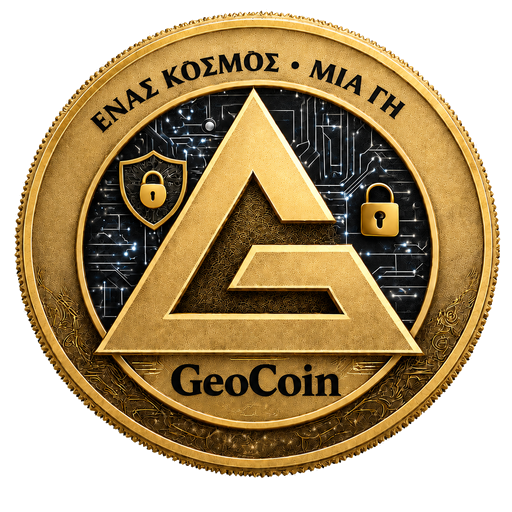

<div align="center">
  
  <h1>GeoCoin</h1>
  <p>Payments · Cadastral NFTs · Sidechains</p>
  <p>Платежи · Кадастровые NFT · Сайдчейны</p>
  <p><strong>C++20 · GeoPoW · Falcon-512 · RocksDB</strong></p>
  <p>
    <a href="#features">Features</a> ·
    <a href="#build">Build</a> ·
    <a href="#run">Run</a> ·
    <a href="#documentation">Docs</a> ·
    <a href="#русский">Русский</a>
  </p>
</div>

GeoCoin is a UTXO blockchain with geographic proof of work, post-quantum
signatures, and encrypted traffic between nodes. This repository contains the
full node, the Qt wallet, miners, database tools, and a C SDK.

**Status:** in development until mainnet launch. RPC API version **1**.

## Features

| Area | Included |
| --- | --- |
| Payments | UTXO, fees, multisig, delegation with limits and revocation, absolute transaction delays |
| Consensus | GeoPoW with global WGS84 area-weighted cell selection, LWMA difficulty adjustment, chain selection by accumulated work |
| Signatures and network | Falcon-512; hybrid ML-KEM-768 + X25519 key exchange and ChaCha20-Poly1305 encryption |
| NFTs and cadastre | Nanodegree WGS84 geometry, holes and multipart parcels, GeoJSON, linked documents, spatial indexing |
| Sidechains | Financial and accounting profiles, deposits, committees, checkpoints, and lifecycle control |
| Data | RocksDB, state recovery, history indexes, archive and pruned modes, consistent backups |

Rules and limits: [blockchain capabilities](docs/BLOCKCHAIN_CAPABILITIES_RU.md)
and [protocol decisions](adr/README.md).

## Build

You need a **C++20** compiler, **CMake 3.22+**, and the dependencies for the
chosen platform. Run every command below from the repository root.

After cloning, fetch the pinned dependencies: `liboqs` and GeographicLib 2.3.0:

```bash
git submodule update --init --recursive
```

### Linux

Supported:

- Ubuntu 20.04, 21.10, 22.04, 22.10, 23.04, 23.10, 24.04, 24.10, 25.04, 25.10, 26.04
- Debian 12, 13

The `dev` profile installs node dependencies. `--with-gui` adds Qt and QR.
If the system RocksDB is older than 6.29.5, the script builds pinned RocksDB 8.9.1
and checks the source SHA-256:

```bash
bash scripts/bootstrap-linux.sh --profile dev --with-gui
cmake --preset linux-release-gui
cmake --build --preset linux-release-gui --parallel
```

Binaries are in `out/build/linux-release-gui/`.
For a build without Qt, use the `linux-release-headless` preset;
its output is `out/build/linux-release/`.

### Windows

Use Visual Studio 2022 with C++ and ClangCL, and vcpkg.
Set `VCPKG_ROOT` and run the commands in x64 Developer PowerShell:

```powershell
cmake --preset windows-clang-static-release-gui
cmake --build --preset windows-clang-static-release-gui --parallel
```

Binaries are in `out/build/windows-clang-static-release-gui/`.

### GPU and SDK

Miner presets are `linux-release-gui-gpu` and
`windows-clang-static-release-gui-gpu`. They require the CUDA Toolkit. HIP and
OpenCL are picked up when the matching SDK is installed.

[Platform and GPU setup](docs/build-and-run.md) ·
[C SDK build](libgeo/README.md) · [CMake layout](cmake/README.md)

## Run

| Program | Role |
| --- | --- |
| `geocoin-core` | Qt wallet with a built-in node |
| `geocoin-node` | Headless node, sync, and RPC |
| `geocoin-gpu-miner` | GPU miner for CUDA, HIP, and OpenCL |
| `geocoin-rpc-miner` | CPU miner through `getblocktemplate` / `submitblock` |
| `geocoin-db` | Schema and data checks, backup, and restore |
| `libgeo` | C SDK for other applications |

**Wallet — Linux:**

```bash
./out/build/linux-release-gui/geocoin-core
```

**Wallet — Windows:**

```powershell
.\out\build\windows-clang-static-release-gui\geocoin-core.exe
```

**Standalone test node — Linux:**

```bash
./out/build/linux-release-gui/geocoin-node \
  --network degree-test \
  --data-dir ./data/testnet \
  --activation-manifest ./config/activation-manifest.testing-testnet.json
```

Node options are printed by `geocoin-node --help`. To load an encrypted wallet,
pass `--wallet-password-file`. Use a separate data directory for each node
instance.

### Networks

| Identifier | Role | P2P | RPC |
| --- | --- | ---: | ---: |
| `degree` | Mainnet | 3030 | 3033 |
| `degree-test` | Testnet | 13030 | 13033 |
| `degree-load` | Isolated load scenarios | 23030 | 23033 |

Each network has its own genesis block and consensus parameters.
They are fixed in [chainparams.cpp](src/geocoin/consensus/chainparams.cpp)
and [genesis.cpp](src/geocoin/core/genesis.cpp).
`degree-load` uses a fixed test difficulty and local fixtures.

### RPC

Enable RPC with `--rpc`. For admin access, add
`--rpc-user admin --rpc-pass-file ./rpc.pass` and put the password on the first
line of that file. On Linux, set `chmod 600 rpc.pass`.

The server listens on `127.0.0.1` by default. Miner and read-only access use
separate accounts. Transport is **JSON-RPC 2.0 over HTTP**.
`getrpcinfo` returns the method catalog and its permissions.

[RPC reference in English](docs/rpc/README_EN.md) ·
[Справочник RPC на русском](docs/rpc/README_RU.md)

### Data maintenance

`geocoin-db schema` prints the database record catalog.
`check`, `backup`, `verify`, and `restore` check the data and maintain
consistent snapshots of the four RocksDB instances. Stop the node before
`check` and `backup`. `restore` writes into a new destination directory.

## Tests

A debug build includes unit, integration, and Qt tests:

```bash
cmake --preset linux-debug-gui
cmake --build --preset linux-debug-gui --parallel
ctest --test-dir out/build/linux-debug-gui --output-on-failure --parallel 4
```

Without Qt, use the `linux-debug-headless` preset and the
`out/build/linux-debug/` directory.

Coverage includes consensus, signatures, delegation, the wallet, RPC, P2P,
RocksDB, recovery, reorgs, and local node clusters.
ASan/UBSan, ThreadSanitizer, and fuzzing are set up separately.

[Load scenarios and how to run them](docs/PRODUCTION_TESTING_RU.md)

## Builds and releases

GitHub Actions builds Linux and Windows packages on `v*` tags or when the
workflow is started by hand. Both platforms use the same source SHA and run
CTest before packaging. A release contains archives, a manifest, an SBOM, and
SHA-256 checksums. A separate manual workflow, Linux container builds, compiles
`geocoin-node` in Ubuntu 20.04–26.04 and Debian 12 and 13 images.

Local portable packages are produced with `make portable-linux` and
`make portable-windows`. Output goes to `out/portable/`.
User, admin and SDK archives are separate; packaging defaults to the user profile.
Use `BUNDLE_PROFILE=admin|sdk` on Linux or `-BundleProfile admin|sdk` on Windows.
Environment setup is described in the [build guide](docs/build-and-run.md).

## Documentation

| Section | Contents |
| --- | --- |
| [Build and run](docs/build-and-run.md) | Platforms, dependencies, GPU, and portable packages |
| [Blockchain capabilities](docs/BLOCKCHAIN_CAPABILITIES_RU.md) | Payments, NFTs, delegation, and sidechains |
| [Architecture](docs/ARCHITECTURE_RU.md) | Project layers and how the components fit together |
| [Protocol and ADRs](adr/README.md) | Authorization, identifiers, checkpoints, and finality |
| [B2B](docs/B2B_FOUNDATION_RU.md) | Corporate roles, cards, and metadata |
| [Testing](docs/PRODUCTION_TESTING_RU.md) | Scenarios under test and pass criteria |
| [Operations](docs/production-mainnet.md) | Node setup and preparation for launch |

Full index: [docs/README.md](docs/README.md).

## Русский

<p>
  <a href="#возможности">Возможности</a> ·
  <a href="#сборка">Сборка</a> ·
  <a href="#запуск">Запуск</a> ·
  <a href="#документация">Документация</a>
</p>

GeoCoin — UTXO-блокчейн с географическим Proof of Work, постквантовыми
подписями и шифрованным обменом между нодами. Репозиторий содержит полную ноду,
Qt-кошелёк, майнеры, инструменты обслуживания базы и C SDK.

**Статус:** разработка до запуска основной сети. Версия RPC API — **1**.

## Возможности

| Направление | Реализовано |
| --- | --- |
| Платежи | UTXO, комиссии, мультиподпись, делегирование с лимитами и отзывом, абсолютные задержки транзакций |
| Консенсус | GeoPoW с выбором ячеек по площади WGS84 по всей Земле, регулировка сложности LWMA, выбор цепи по накопленной работе |
| Подписи и сеть | Falcon-512; гибридный обмен ключами ML-KEM-768 + X25519 и шифрование ChaCha20-Poly1305 |
| NFT и кадастр | WGS84 в наноградусах, отверстия и составные участки, GeoJSON, привязанные документы, пространственный индекс |
| Сайдчейны | Финансовый и учётный профили, депозиты, комитеты, контрольные точки и управление жизненным циклом |
| Данные | RocksDB, восстановление состояния, индексы истории, архивный и pruned-режимы, согласованные резервные копии |

Подробные правила и ограничения: [возможности блокчейна](docs/BLOCKCHAIN_CAPABILITIES_RU.md)
и [решения по протоколу](adr/README.md).

## Сборка

Нужны компилятор с поддержкой **C++20**, **CMake 3.22+** и зависимости выбранной
платформы. Все команды ниже выполняются из корня репозитория.

После клонирования загрузите закреплённые зависимости: `liboqs` и GeographicLib 2.3.0:

```bash
git submodule update --init --recursive
```

### Linux

Поддерживаются:

- Ubuntu 20.04, 21.10, 22.04, 22.10, 23.04, 23.10, 24.04, 24.10, 25.04, 25.10, 26.04
- Debian 12, 13

Профиль `dev` ставит зависимости ноды. `--with-gui` добавляет Qt и QR.
Если системная RocksDB старее 6.29.5, скрипт собирает зафиксированную RocksDB 8.9.1
с проверкой SHA-256 исходников:

```bash
bash scripts/bootstrap-linux.sh --profile dev --with-gui
cmake --preset linux-release-gui
cmake --build --preset linux-release-gui --parallel
```

Бинарники находятся в `out/build/linux-release-gui/`.
Для сборки без Qt используйте preset `linux-release-headless`;
его результат — `out/build/linux-release/`.

### Windows

Используйте Visual Studio 2022 с C++ и ClangCL, а также vcpkg.
Задайте `VCPKG_ROOT` и выполните команды в x64 Developer PowerShell:

```powershell
cmake --preset windows-clang-static-release-gui
cmake --build --preset windows-clang-static-release-gui --parallel
```

Бинарники находятся в `out/build/windows-clang-static-release-gui/`.

### GPU и SDK

Для майнера доступны presets `linux-release-gui-gpu` и
`windows-clang-static-release-gui-gpu`. Они требуют CUDA Toolkit; HIP и OpenCL
подключаются при наличии соответствующих SDK.

[Подробная настройка платформ и GPU](docs/build-and-run.md) ·
[Сборка C SDK](libgeo/README.md) · [Устройство CMake](cmake/README.md)

## Запуск

| Приложение | Назначение |
| --- | --- |
| `geocoin-core` | Qt-кошелёк со встроенной нодой |
| `geocoin-node` | Нода без графического интерфейса, синхронизация и RPC |
| `geocoin-gpu-miner` | GPU-майнер для CUDA, HIP и OpenCL |
| `geocoin-rpc-miner` | CPU-майнер через `getblocktemplate` / `submitblock` |
| `geocoin-db` | Проверка схемы и данных, резервное копирование и восстановление |
| `libgeo` | C SDK для внешних приложений |

**Кошелёк — Linux:**

```bash
./out/build/linux-release-gui/geocoin-core
```

**Кошелёк — Windows:**

```powershell
.\out\build\windows-clang-static-release-gui\geocoin-core.exe
```

**Отдельная тестовая нода — Linux:**

```bash
./out/build/linux-release-gui/geocoin-node \
  --network degree-test \
  --data-dir ./data/testnet \
  --activation-manifest ./config/activation-manifest.testing-testnet.json
```

Параметры ноды доступны через `geocoin-node --help`. Для загрузки зашифрованного
кошелька укажите `--wallet-password-file`; для разных экземпляров ноды используйте
отдельные каталоги данных.

### Сети

| Идентификатор | Назначение | P2P | RPC |
| --- | --- | ---: | ---: |
| `degree` | Основная сеть | 3030 | 3033 |
| `degree-test` | Тестовая сеть | 13030 | 13033 |
| `degree-load` | Изолированные нагрузочные сценарии | 23030 | 23033 |

У каждой сети собственные genesis и параметры консенсуса.
Они закреплены в [chainparams.cpp](src/geocoin/consensus/chainparams.cpp)
и [genesis.cpp](src/geocoin/core/genesis.cpp).
`degree-load` использует фиксированную тестовую сложность и локальные фикстуры.

### RPC

RPC включается параметром `--rpc`. Для административного доступа добавьте
`--rpc-user admin --rpc-pass-file ./rpc.pass`, предварительно сохранив пароль
в первой строке файла. В Linux установите права `chmod 600 rpc.pass`.

По умолчанию сервер слушает `127.0.0.1`. Для майнера и чтения предусмотрены
отдельные учётные записи. Транспорт — **JSON-RPC 2.0 поверх HTTP**;
каталог доступных методов и их прав возвращает `getrpcinfo`.

[Справочник RPC на русском](docs/rpc/README_RU.md) ·
[RPC reference in English](docs/rpc/README_EN.md)

### Обслуживание данных

`geocoin-db schema` показывает каталог записей базы.
Команды `check`, `backup`, `verify` и `restore` проверяют данные и обслуживают
согласованные снимки четырёх RocksDB. Для `check` и `backup` ноду необходимо
остановить; `restore` использует новый каталог назначения.

## Тесты

Debug-сборка включает модульные, интеграционные и Qt-тесты:

```bash
cmake --preset linux-debug-gui
cmake --build --preset linux-debug-gui --parallel
ctest --test-dir out/build/linux-debug-gui --output-on-failure --parallel 4
```

Для проверки без Qt используйте preset `linux-debug-headless` и каталог
`out/build/linux-debug/`.

Набор охватывает консенсус, подписи, делегации, кошелёк, RPC, P2P,
RocksDB, восстановление, реорганизации и локальные кластеры нод.
Отдельно предусмотрены ASan/UBSan, ThreadSanitizer и fuzzing.

[Нагрузочные сценарии и команды запуска](docs/PRODUCTION_TESTING_RU.md)

## Сборки и релизы

GitHub Actions собирает Linux- и Windows-пакеты по тегам `v*` или при ручном
запуске workflow. Обе платформы используют один SHA исходников и проходят
CTest до упаковки. В релиз входят архивы, manifest, SBOM и SHA-256.
Отдельный ручной workflow Linux container builds собирает `geocoin-node`
в образах Ubuntu 20.04–26.04 и Debian 12 и 13.

Локальные portable-пакеты создаются через `make portable-linux` и
`make portable-windows`; результат сохраняется в `out/portable/`.
Пользовательский комплект, инструменты администратора и SDK поставляются отдельно.
Профиль по умолчанию — `user`; для остальных задайте `BUNDLE_PROFILE=admin|sdk`
на Linux или `-BundleProfile admin|sdk` на Windows.
Подготовка окружения описана в [руководстве по сборке](docs/build-and-run.md).

## Документация

| Раздел | Что найти |
| --- | --- |
| [Сборка и запуск](docs/build-and-run.md) | Платформы, зависимости, GPU и portable-пакеты |
| [Возможности блокчейна](docs/BLOCKCHAIN_CAPABILITIES_RU.md) | Платежи, NFT, делегации и сайдчейны |
| [Архитектура](docs/ARCHITECTURE_RU.md) | Слои проекта и взаимодействие компонентов |
| [Протокол и ADR](adr/README.md) | Авторизация, идентификаторы, checkpoint и finality |
| [B2B](docs/B2B_FOUNDATION_RU.md) | Корпоративные роли, карты и метаданные |
| [Тестирование](docs/PRODUCTION_TESTING_RU.md) | Проверяемые сценарии и критерии прохождения |
| [Эксплуатация](docs/production-mainnet.md) | Настройка и подготовка ноды к запуску |

Полный указатель: [docs/README.md](docs/README.md).
