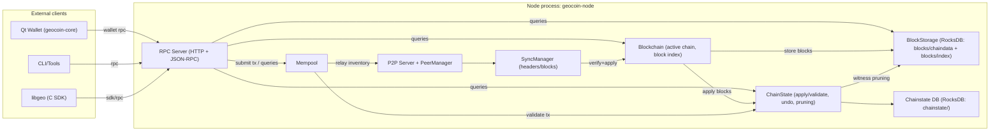

# GeoCoin — Architecture

> Русская версия: [ARCHITECTURE_RU.md](ARCHITECTURE_RU.md)

**Date:** April 16, 2026

The goal of this page is to give a holistic picture of the project and explain
how data travels the path **p2p → validate → storage/state → rpc/wallet**.
After reading it, the RPC reference becomes easier to navigate: it is clear
"which layer is responsible for what".

## High-level overview

The `geocoin-node` node assembles in a single process. `degree_node` is the
legacy compatible alias of the same binary. It brings together:

- the P2P subsystem (connections, messages, synchronization)
- the mempool (policy + anti-replay indexes)
- consensus validation (block/transaction rules)
- storage (blocks and indexes in RocksDB)
- state (chainstate in RocksDB, block application, undo, pruning)
- RPC (JSON-RPC over HTTP)

The subsystem assembly point: `geocoin::node::Node`. The lifecycle lives in
`../src/geocoin/node/node.cpp`, periodic tasks in `node_runtime_loop.cpp`,
and public operations and chain events in `node_services.cpp`.

## P2P layer

### What it does

- Accepts inbound connections and initiates outbound connections.
- Authenticates peers (several authentication rounds).
- Delivers messages to the synchronization subsystem and to the relay logic
  (inv/getdata).

### Where in the code

- TCP listener/accept loop: `../src/geocoin/network/p2p_server.cpp`
- Peer management, limits, authentication, broadcast:
  `../src/geocoin/network/peer_manager.cpp`, `../src/geocoin/network/peer.cpp`
- P2P message formats and serialization (payload limits and validation):
  `../src/geocoin/network/messages.cpp`

### Contracts/constraints (important)

- Messages have payload size limits (protection against simple DoS).
- PeerManager enforces upper limits on inbound/outbound connections and
  timeouts (see the constants in `peer_manager.cpp`).

## Validation layer

It is convenient to split validation into two parts:

1) **Consensus validation of blocks** (structure, PoW, epoch/height rules,
   contextual checks).
2) **Transaction validation** against the current state (UTXO/balances/
   transaction-type rules).

### Blocks: check → apply

The typical path for an incoming block:

- The network/SyncManager receives a block candidate and calls verify/apply.
- Blockchain runs `consensus::check_block(...)` and
  `consensus::contextual_check_block(...)`.
- On success the block is applied via `ChainState::apply_block(...)` and
  stored in `BlockStorage`.

Code landmarks:

- Sync pipeline: `../src/geocoin/network/sync_manager.cpp` (see
  `verify_and_apply_block`)
- Active chain and block checks: `../src/geocoin/core/blockchain.cpp`
- Consensus checks: `../src/geocoin/consensus/` (see the calls from
  `blockchain.cpp`)
- State application: `../src/geocoin/state/state.cpp`,
  `../include/geocoin/state/state.hpp`

### Transactions: verify/validate → mempool

The typical path for a transaction:

- The transaction arrives via RPC or p2p.
- The mempool performs preliminary checks and calls
  `ChainState::validate_transaction(tx)` (expensive checks run before the
  mempool mutex is taken).
- On success the transaction enters the mempool and can be relayed to other
  peers.

Code landmarks:

- Mempool: `../src/geocoin/network/mempool.cpp`
- Policy/constraints: `../src/geocoin/network/mempool_policy.cpp`
- State validation: `../src/geocoin/state/state.cpp`

## Storage & State layer

### BlockStorage (blocks)

BlockStorage keeps blocks and indexes in RocksDB (the `blocks/` folder inside
the data-dir).

- Interface: `../include/geocoin/storage/block_storage.hpp`
- Implementation: `../src/geocoin/storage/block_storage.cpp`

Besides plain block reading/writing, BlockStorage supports:

- an active-chain index by height (fork-safe storage of the "active" set
  separately),
- witness pruning and storing the witness payload separately from the
  pruned block.

### ChainState (state)

ChainState keeps the chainstate in RocksDB (the `chainstate/` folder inside
the data-dir) and is responsible for:

- `apply_block(...)` (applying a block to the state),
- `validate_transaction(...)` (validating a transaction against the current
  state),
- undo/journaling for crash correctness,
- archive/pruned modes and background witness pruning.

Interface/undo structures: `../include/geocoin/state/state.hpp`
Implementation: `../src/geocoin/state/state.cpp`
Storage backend (RocksDB): `../src/geocoin/state/storage.cpp`,
`../include/geocoin/state/storage.hpp`

### Witness pruning

Payload storage, witness removal, and integrity checks are implemented in:

- `../src/geocoin/storage/block_storage.cpp`

## RPC & Wallet layer

### RPC: HTTP + JSON-RPC

The node runs an HTTP server and handles JSON-RPC requests via POST. There is
baseline protection:

- HTTP Basic auth (rpc user/pass)
- throttling for brute-force attempts

Code landmarks:

- HTTP transport: `../src/geocoin/rpc/rpc_protocol.cpp`
- JSON-RPC dispatch and lifecycle: `../src/geocoin/rpc/rpc_server.cpp`
- Authentication/rate limits: `../src/geocoin/rpc/rpc_server_security.cpp`
- Method groups (blockchain/wallet/mining/network/misc):
  `../src/geocoin/rpc/`

### Wallet

The wallet exists in two forms:

- GUI (Qt): `../src/qt/`
- Wallet RPC methods: `../src/geocoin/rpc/rpc_wallet.cpp`

## Related documents

- Documentation index: [README.md](README.md)
- Technical overview (EN): [TECHNICAL_OVERVIEW.md](TECHNICAL_OVERVIEW.md)
- RPC reference (RU): `rpc/README_RU.md`
- RPC reference (EN): `rpc/README_EN.md`
- Security: `../src/geocoin/crypto/signatures.cpp`,
  `../src/geocoin/storage/block_storage.cpp`
- Build/run: [build-and-run.md](build-and-run.md)
