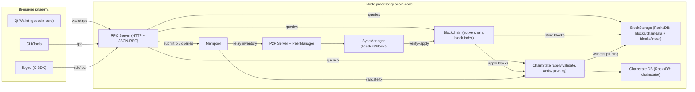

# GeoCoin — Architecture

**Дата:** 16 апреля 2026

Цель этой страницы — дать целостную картину проекта и объяснить, как данные проходят путь **p2p → validate → storage/state → rpc/wallet**. После неё читать справочник RPC проще: становится понятно, «какой слой отвечает за что».

## High-level overview

Нода `geocoin-node` собирает в одном процессе. `degree_node` — старый совместимый alias того же бинаря.

- P2P подсистему (соединения, сообщения, синхронизация)
- Mempool (policy + anti-replay индексы)
- Консенсусную валидацию (правила блока/транзакций)
- Storage (блоки и индексы в RocksDB)
- State (chainstate в RocksDB, применение блоков, undo, pruning)
- RPC (JSON-RPC поверх HTTP)

Точка сборки подсистем: `geocoin::node::Node`. Жизненный цикл находится в
`../src/geocoin/node/node.cpp`, периодические задачи — в `node_runtime_loop.cpp`,
а публичные операции и события цепи — в `node_services.cpp`.

## Слой P2P

### Что делает

- Принимает inbound соединения и инициирует outbound подключения.
- Аутентифицирует пиров (несколько раундов аутентификации).
- Доставляет сообщения в подсистему синхронизации и в логику relay (inv/getdata).

### Где в коде

- TCP listener/accept loop: `../src/geocoin/network/p2p_server.cpp`
- Управление пирами, лимиты, аутентификация, broadcast: `../src/geocoin/network/peer_manager.cpp`, `../src/geocoin/network/peer.cpp`
- Форматы p2p сообщений и сериализация (лимиты payload и валидации): `../src/geocoin/network/messages.cpp`

### Контракты/ограничения (важное)

- У сообщений есть лимиты размера payload (защита от простых DoS).
- PeerManager держит верхние лимиты inbound/outbound и таймауты (см. константы в `peer_manager.cpp`).

## Слой Validation

Валидацию удобно разделять на две части:

1) **Консенсусная проверка блоков** (структура, PoW, правила эпох/высоты, contextual checks).
2) **Проверка/валидация транзакций** относительно текущего состояния (UTXO/балансы/правила типов транзакций).

### Блоки: check → apply

Типовой путь на входящем блоке:

- Сеть/SyncManager получает кандидат блока и вызывает verify/apply.
- Blockchain выполняет `consensus::check_block(...)` и `consensus::contextual_check_block(...)`.
- При успехе блок применяется в `ChainState::apply_block(...)` и сохраняется в `BlockStorage`.

Ориентиры в коде:

- Sync pipeline: `../src/geocoin/network/sync_manager.cpp` (см. `verify_and_apply_block`)
- Активная цепь и проверки блока: `../src/geocoin/core/blockchain.cpp`
- Консенсусные проверки: `../src/geocoin/consensus/` (см. вызовы из `blockchain.cpp`)
- Применение к состоянию: `../src/geocoin/state/state.cpp`, `../include/geocoin/state/state.hpp`

### Транзакции: verify/validate → mempool

Типовой путь для транзакции:

- Транзакция приходит через RPC или p2p.
- Mempool делает предварительные проверки и вызывает `ChainState::validate_transaction(tx)` (дорогостоящие проверки выполняются до взятия mutex mempool).
- При успехе транзакция попадает в mempool и может быть разослана другим пирам.

Ориентиры в коде:

- Mempool: `../src/geocoin/network/mempool.cpp`
- Policy/ограничения: `../src/geocoin/network/mempool_policy.cpp`
- State validation: `../src/geocoin/state/state.cpp`

## Слой Storage & State

### BlockStorage (блоки)

BlockStorage хранит блоки и индексы в RocksDB (папка `blocks/` внутри `data-dir`).

- Интерфейс: `../include/geocoin/storage/block_storage.hpp`
- Реализация: `../src/geocoin/storage/block_storage.cpp`

Кроме обычного чтения/записи блоков, BlockStorage поддерживает:

- индекс активной цепи по высоте (fork-safe хранение «активного» набора отдельно),
- witness pruning и хранение witness payload отдельно от pruned-блока.

### ChainState (состояние)

ChainState хранит chainstate в RocksDB (папка `chainstate/` внутри `data-dir`) и отвечает за:

- `apply_block(...)` (применение блока к состоянию),
- `validate_transaction(...)` (проверка транзакции относительно текущего состояния),
- undo/журналирование для корректности при сбоях,
- режимы archive/pruned и фоновые операции witness pruning.

Интерфейс/структуры undo: `../include/geocoin/state/state.hpp`
Реализация: `../src/geocoin/state/state.cpp`
Storage backend (RocksDB): `../src/geocoin/state/storage.cpp`, `../include/geocoin/state/storage.hpp`

### Witness pruning

Хранение payload, удаление witness и проверки целостности реализованы в:

- `../src/geocoin/storage/block_storage.cpp`

## Слой RPC & Wallet

### RPC: HTTP + JSON-RPC

Нода поднимает HTTP сервер и обрабатывает JSON-RPC запросы через POST. Есть базовая защита:

- HTTP Basic auth (rpc user/pass)
- throttling для brute-force попыток

Ориентиры в коде:

- HTTP transport: `../src/geocoin/rpc/rpc_protocol.cpp`
- JSON-RPC dispatch и lifecycle: `../src/geocoin/rpc/rpc_server.cpp`
- Аутентификация/rate limits: `../src/geocoin/rpc/rpc_server_security.cpp`
- Группы методов (blockchain/wallet/mining/network/misc): `../src/geocoin/rpc/`

### Wallet

Кошелёк существует в двух формах:

- GUI (Qt): `../src/qt/`
- RPC методы кошелька: `../src/geocoin/rpc/rpc_wallet.cpp`

## Связанные документы

- Индекс документации: `README.md`
- Технический обзор (RU): `TECHNICAL_OVERVIEW_RU.md`
- RPC reference (RU): `rpc/README_RU.md`
- RPC reference (EN): `rpc/README_EN.md`
- Security: `../src/geocoin/crypto/signatures.cpp`, `../src/geocoin/storage/block_storage.cpp`
- Build/run: `build-and-run.md`
